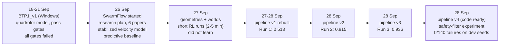
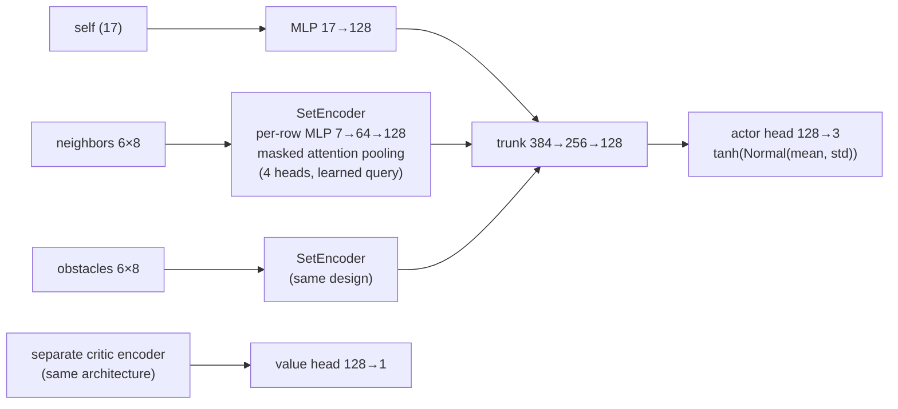
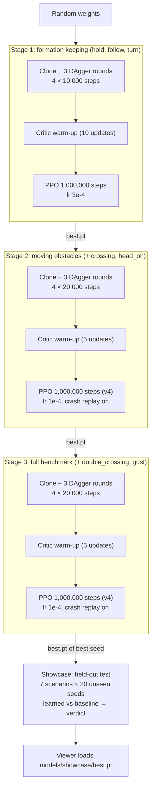
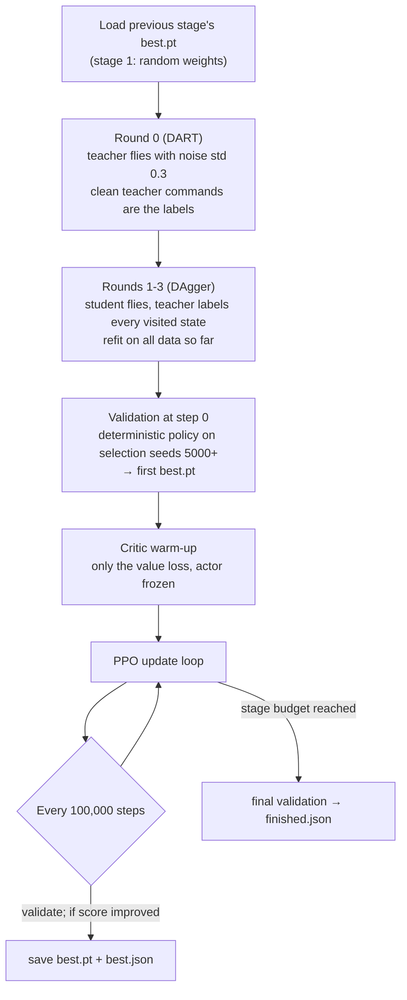
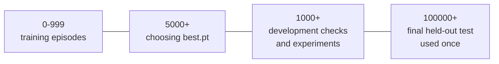
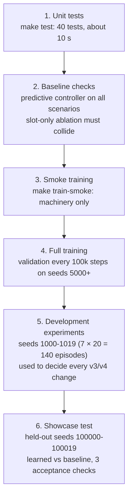
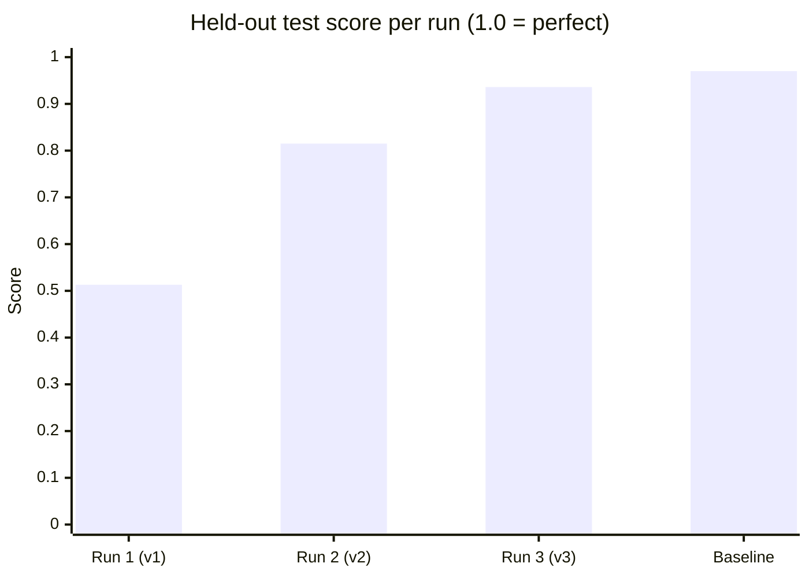
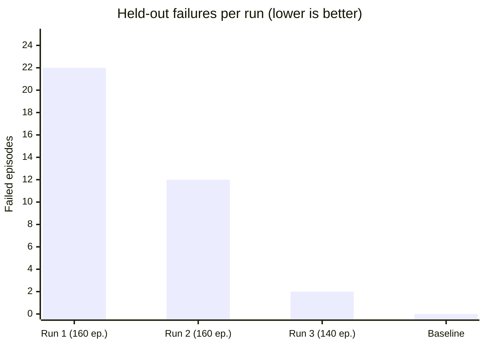

# SwarmFlow knowledge base

**One file that explains the whole project**: the goal, every research paper we used and what we took from it, what we used before and what we use now, how training works phase by phase, every training run and its numbers, the problems we hit, how we test, where we stand, the limitations, and where every file lives.

Last updated: **28 September 2026**. Project folder: `BTP/Drone-Swarm`. All numbers below come from files in this repository; the file is named next to each claim so it can be checked.

> **How to keep this file current.** When you add a paper, add a row to [section 5](#5-research-papers-what-we-took-from-each) and name the code it changed. When you finish a training run, add a column to the results table in [section 9](#9-every-training-run-and-its-results) and a short "what went wrong / what we changed" entry in [section 10](#10-problems-we-hit-and-how-we-fixed-them). Keep [section 11](#11-where-we-are-now) (current status) short and true.

---

## Contents

1. [Goal and research question](#1-goal-and-research-question)
2. [Project timeline](#2-project-timeline)
3. [What we used before, and what we use now](#3-what-we-used-before-and-what-we-use-now)
4. [The system: environment, observations, reward, network](#4-the-system-environment-observations-reward-network)
5. [Research papers: what we took from each](#5-research-papers-what-we-took-from-each)
6. [How training works (phases, with diagrams)](#6-how-training-works-phases-with-diagrams)
7. [Hyperparameters, epochs and budgets per version](#7-hyperparameters-epochs-and-budgets-per-version)
8. [Testing and evaluation flow](#8-testing-and-evaluation-flow)
9. [Every training run and its results](#9-every-training-run-and-its-results)
10. [Problems we hit and how we fixed them](#10-problems-we-hit-and-how-we-fixed-them)
11. [Where we are now](#11-where-we-are-now)
12. [Current limitations](#12-current-limitations)
13. [Next steps](#13-next-steps)
14. [File map: where everything is](#14-file-map-where-everything-is)
15. [Command cheat sheet](#15-command-cheat-sheet)
16. [Glossary](#16-glossary)

---

## 1. Goal and research question

**Goal: reinforcement learning for drone-swarm technologies.** Concretely, one neural network, shared by every drone, that flies a swarm using only what each drone can sense nearby.

**The task (SwarmFlow: "follow, yield, recover").**

- 8 drones follow a moving reference target at a fixed stand-off distance, each in its own **formation slot**.
- An object crosses the flight path. The drones leave their slots, avoid the object and each other, then return to **their own** slots (not any free slot) relative to the moving target.
- No capture, pursuit or contact objective. The target path is scripted and does not react to the swarm.

**Research question** (`docs/research-plan.md`):

> Can a decentralized learned controller reduce formation disturbance and recovery time while matching the collision rate of a predictive classical controller, including on unseen obstacle trajectories and swarm sizes?

This is treated as a hypothesis to test, not a claimed novelty. The closest prior work (Batra et al., CoRL 2021) already shows swarms re-forming around moving obstacles.

**What counts as success** (the acceptance checks in `evaluate.learning_checks`, from `docs/research-plan.md`), on 20 unseen seeds per scenario:

| Check | Target |
| --- | --- |
| Safety | no collisions or other failures |
| Recovery | at least 95% of disturbances recovered within 5 s |
| Precision | slot RMSE below 0.35 m on hold, follow and turn |

A model passes ("LEARNED CORRECTLY") only if all three pass.

---

## 2. Project timeline



(Scores are held-out test scores; the hand-coded baseline scores 0.962-0.970 on the same seeds. See section 9.)

| Date (2026) | What happened | Evidence | Who (git author) |
| --- | --- | --- | --- |
| 18-21 Sep | **BTP1_v1**, the earlier project on Windows: training runs with pass/fail "gates"; every gate failed (`hold_failed`, `collision_or_bounds`). | `results/archive/` (111 runs), `results/submit/` | – |
| 26 Sep | **SwarmFlow initial project**: environment, predictive baseline, viewer, research plan from 6 papers. | commit `af524ac`, `docs/research-plan.md` | sumit kumar |
| 27 Sep | Formation geometries (grid, circle, square, triangle) and worlds (hills, canyon, pillars); the BTP1 results archive was added to the repo. | commit `af37a86` | Dheeraj Sharma |
| 27 Sep evening | First RL runs of 2-5 minutes: numbered test runs 01-10. They did not learn (84% crashes, drones flew out of the world). | `runs/tests/`, `runs/stage1-seed0`, `training.md` section 2 | – |
| 27 Sep 23:31 | **Training pipeline rebuilt** (pipeline v1): cloning + DAgger, separate critic, bounded reward, 3-stage curriculum, best-checkpoint selection, showcase test. | commit `9f2bfee`, `training.md` sections 1-18 | Nishantnsut27 |
| 28 Sep 00:46-08:30 | **Run 1** (pipeline v1). Stage 1 worked; stages 2-3 collapsed. Test score 0.513. | `models/previous-runs/run1-pipeline-v1/` | – |
| 28 Sep 08:51 | **Pipeline v2**: cloning in every stage, imitation loss in PPO, exploration floor, per-drone crash penalty, 1 m obstacle warning, wider network. | commit `d884f69`, `training.md` Part C | Nishantnsut27 |
| 28 Sep 09:49-14:17 | **Run 2** (pipeline v2). Test score 0.815; 12 grazing collisions. | `models/previous-runs/run2-pipeline-v2/` (also still in `models/showcase/`) | – |
| 28 Sep 15:55 | **Pipeline v3**: cautious teacher (0.6 / 0.25 m), stronger imitation (1.0 → 0.5), slalom removed. | commit `1c1b7c3`, `training.md` Part D | Nishantnsut27 |
| 28 Sep (day) | **Run 3** (pipeline v3), trained on a teammate's laptop (branch `sumit`). Test score 0.936, 2 failures. | `models/previous-runs/run3-pipeline-v3/` | – |
| 28 Sep 22:19-22:23 | **Safety-filter experiment** on development seeds: 0/140 failures, all checks pass. | `runs/experiments/shield.py`, `shield_*.log` | – |
| 28 Sep 22:30 | **Pipeline v4**: teacher margin 0.7 / 0.3 m, recovery counted after overlapping objects, 1M PPO steps in stages 2-3. Full run not done yet. | commit `c4f7249`, `training.md` Part E | Nishantnsut27 |

---

## 3. What we used before, and what we use now

### 3.1 Phase 0: BTP1_v1 (before SwarmFlow)

What the repository shows about the earlier project (`results/`, and the labels in `graphify-out/.graphify_labels.json`):

- A quadrotor model with a geometric PID controller, commands at the attitude level ("ADR 0001: flight cmd is attitude, not motors"), and a Gazebo-style viewer.
- A PPO actor-critic trained on Windows (`D:\Presonal Project\BTP1_v1`), judged by three pass/fail **gates** (`pass_gate.py`).
- 100 archived runs between 18 and 21 September (`results/archive/`: 53 baseline, 38 train, 9 prod).
- Outcome: **no run passed its gates**. The last submitted run (`results/submit/result.md`, 21 Sep) failed all three gates with `hold_failed` and errors of 45, 172 and 145. Its metrics log (`results/submit/data/metrics.csv`) still records about 1,900 collisions per 2,048-step block after 2.66M steps.

The SwarmFlow plan starts fresh from this: "Independent project; no source copied from the existing `btp` project or QuadSwarm" (`docs/research-plan.md`).

### 3.2 Before vs now

| | Before | Now (SwarmFlow, pipeline v4) |
| --- | --- | --- |
| Flight model | BTP1: quadrotor + attitude-level commands | Stabilized **velocity-level** 3D flight model (NumPy), 20 Hz, 0.28 s response, 5 m/s² accel limit, 3 m/s speed limit |
| What RL learns | Everything at once (stabilizing + coordinating + avoiding) | Only swarm coordination and avoidance, above a stable flight controller (`docs/research-plan.md`, "Direction") |
| Formation | – | Persistent, target-relative slots; slot identity never changes in an episode |
| Reference controller | – | Hand-coded **predictive baseline** (`PredictiveController`): samples velocities, predicts 2 s ahead, penalizes clearance violations |
| Early RL (27 Sep) | 2-5 min runs: 150,000 PPO steps, one environment, shared actor-critic, always-negative reward, clone only perfect states | 3 stages, 3M PPO steps (v4), 8 parallel environments, separate critic, bounded reward with +1/s alive, DART + DAgger in every stage |
| Model choice | Last weights (`latest.pt`) | Best validated weights (`best.pt`) on dedicated selection seeds |
| Testing | Same seeds for tuning and reporting; BTP1 used gates | Four separate seed ranges, a held-out final test on 140 unseen episodes, three acceptance checks |
| Viewer | Hand-coded controller only | Learned model by default, live training progress, "Did the model learn correctly?" panel |

---

## 4. The system: environment, observations, reward, network

### 4.1 Environment (`src/swarmflow/env.py`, `scenarios.py`, `config.py`)

- **API**: PettingZoo `ParallelEnv` with Gymnasium spaces; one agent per drone; all drones act at the same time.
- **Time**: `dt` = 0.05 s (20 Hz) with 5 physics substeps; an episode is 24 s (480 steps).
- **Swarm**: 8 drones (2-32 allowed), radius 0.18 m, slot spacing 1.25 m (0.89 m surface gap), altitude 3 m, 3 m behind a target moving at 0.55 m/s.
- **Action**: 3 numbers in [−1, 1], a desired velocity scaled to at most 3 m/s.
- **Collisions**: swept checks over every 10 ms substep, so fast objects cannot tunnel through. Any collision, touching the ground or leaving the world (±60 m, 0-10 m altitude) ends the episode for the whole team. No collision is ever "repaired".
- **Scenarios in the environment** (`SCENARIOS`): hold, follow, crossing, head_on, double_crossing, slalom, dense, turn, gust, pilot, terrain_follow.
  - **Training/test benchmark (v3+)**: hold, follow, crossing, head_on, double_crossing, turn, gust (`curriculum.SHOWCASE_SCENARIOS`). Slalom was removed in v3 (section 10).
- **Formation geometries** (`config.GEOMETRIES`): grid (default), circle, square, triangle.
- **Worlds** (`config.WORLDS`): empty (default), hills, canyon, pillars. Only `empty` is used in training.

### 4.2 Observations (local and relative only)

| Part | Size | Content |
| --- | --- | --- |
| `self` | 17 | slot error xyz, own velocity xyz, target velocity xyz, previous command xyz, slot offset xyz, altitude, remaining episode fraction |
| `neighbors` | 6 × 8 | nearest drones within 7 m: relative position xyz, relative velocity xyz, radius, valid mask |
| `obstacles` | 6 × 8 | the same for external objects |

No global state, no future path, no other drones' goals. Optional: Gaussian position noise, row dropout, short-range rays (`Config.noise`, `dropout`, `rays`).

### 4.3 Reward (`SwarmEnv._reward`, current version)

Per drone and step, with slot error `e` capped at 5 m:

```text
tracking = e²  if e ≤ 1 m,  else 2e − 1
cost     = tracking + 0.12·v_err² + 6·(drone proximity inside 0.45 m)
           + 3·Σ(1 − gap/1 m)² over objects closer than 1 m (capped at two objects)
           + 0.005·|u|² + 0.001·|Δu/dt|²          (all terms capped)
reward   = dt·(1 − cost)                           (+1 per second alive, minus costs)
failure  : −100 for each drone involved in the collision; the episode ends for everyone
```

Every cost is bounded, so with γ = 0.99 staying alive always beats crashing (worst alive return ≈ −60 > −100). Checked by `test_reward_is_bounded_and_failure_is_always_worse`.

### 4.4 Network (`src/swarmflow/policy.py`)



- **Parameter sharing**: one network for all drones; each drone runs it on its own observation, so it works for any swarm size.
- **Permutation invariance**: neighbor order does not matter (masked attention pooling from the Set Transformer), checked by `test_attention_encoder_permutation_invariance`.
- **Separate critic** with its own encoder (default since pipeline v1). Width 128 since v2: about 284k actor and 284k critic parameters (v1 used width 64, about 72k each).
- **Default is IPPO** (local critic). `--critic central` gives a MAPPO-style centralized value head as an option.
- Evaluation and the viewer use the deterministic action `tanh(mean)`. **No safety filter or baseline runs behind the learned policy** in the benchmark.

### 4.5 Controllers used for comparison (`src/swarmflow/baseline.py`)

- `PredictiveController`: the hand-coded reference and the teacher for imitation. Soft/hard clearance margins 0.35 / 0.08 m as a baseline; 0.7 / 0.3 m as the v4 teacher.
- `SlotController`: slot-only ablation with no avoidance. It collides in every obstacle scenario, which proves the obstacles matter.

---

## 5. Research papers: what we took from each

### 5.1 The six domain papers that shaped the benchmark (`docs/research-plan.md`, `sofar.md`)

| Paper | What it gave us | Where it is in the code | Deliberately not copied |
| --- | --- | --- | --- |
| **Batra et al., *Decentralized Control of Quadrotor Swarms with End-to-end Deep RL*, CoRL 2021** ([arXiv 2109.07735](https://arxiv.org/abs/2109.07735)) | Shared decentralized policy; local neighbor position/velocity; permutation-invariant (deep-set / attention) encoders; PPO; moving spherical obstacles with formation re-establishment; separate collision and formation metrics; later (v2) per-drone collision penalties and a smooth warning zone. | `policy.py` (`SetEncoder`, parameter sharing), `env.py` (`_observe`, `_reward`, `culprits`, `OBSTACLE_MARGIN_M`) | Direct thrust control; its ~1 billion-sample budget; its reported numbers |
| **Huang et al., *Collision Avoidance and Navigation for a Quadrotor Swarm Using End-to-end Deep RL*, ICRA 2024** ([arXiv 2309.13285](https://arxiv.org/abs/2309.13285)) | Bounded obstacle observations with masks; noise/dropout option; pre-collision state replay with fresh on-policy rollouts; attention encoders; the idea of distance ("gap") features. | `env.py` (masks, rays, noise), `train.Worker` (`--failure-reset`, on in stages 2-3), `SetEncoder(gap_features)` (tested in v4, off) | Its dense full-height static-obstacle benchmark |
| **Huang et al., *QuadSwarm*, ICRA 2023 workshop** ([arXiv 2306.09537](https://arxiv.org/abs/2306.09537), [repo](https://github.com/Zhehui-Huang/quad-swarm-rl)) | Separate simulation from rendering; seeded, randomized scenario generation; configurable counts, sensors and disturbances. Its training script was the reference for our v2 hyperparameters (lr 1e-4, width, entropy 0). | `env.py` vs `server.py`/`web/`, `scenarios.py`, `curriculum.STAGES` | The simulator itself; direct thrust |
| **Yu et al., *The Surprising Effectiveness of PPO in Cooperative Multi-Agent Games*, NeurIPS 2022** ([arXiv 2103.01955](https://arxiv.org/abs/2103.01955)) | Cooperative PPO as a serious baseline; parameter sharing; value normalization; few epochs; clip ≤ 0.2; large batches; optional centralized critic. | `train.py` (PPO loop, `RewardScaler`), `--critic central` | Any claim of MAPPO parity |
| **Panerati et al., *Learning to Fly* (gym-pybullet-drones), IROS 2021** ([arXiv 2103.02142](https://arxiv.org/abs/2103.02142)) | The decision to keep a fast stabilized model now and validate on full physics later; a clean interface between task logic, controller actions and simulation state. | `env.py` flight model; `docs/implementation.md` | 6-DOF dynamics, downwash, hardware (future work) |
| **van den Berg et al., *Reciprocal n-body Collision Avoidance* (ORCA), ISRR 2011** ([project](https://gamma-web.iacs.umd.edu/ORCA/)) | Predict relative motion; relative position and velocity in observations; the sampled receding-horizon predictive baseline; continuous swept collision checks. | `baseline.PredictiveController`, `env._clearance` | ORCA's linear program and its formal guarantees (our baseline is **not** ORCA) |

### 5.2 Training-method papers (pipeline v1, `training.md` section 7)

| Paper | What we use | Code |
| --- | --- | --- |
| Schulman et al., *Proximal Policy Optimization Algorithms*, 2017 | Clipped surrogate (ε = 0.2), several epochs per batch | `train.py` update loop |
| Schulman et al., *Generalized Advantage Estimation*, ICLR 2016 | GAE with γ = 0.99, λ = 0.95 | `train.advantages` |
| de Witt et al., *Is Independent Learning All You Need in SMAC?*, 2020 | Independent PPO with a local critic as the default | default `critic="local"` |
| Andrychowicz et al., *What Matters in On-Policy RL?*, ICLR 2021 | Separate actor and critic networks, small last-layer init, low initial action std, tanh squashing, Adam 3e-4 | `policy.ActorCritic`, `init_log_std` |
| Engstrom et al., *Implementation Matters in Deep Policy Gradients*, ICLR 2020 | Reward scaling, learning-rate annealing, orthogonal init, gradient clipping | `RewardScaler`, lr schedule |
| Huang et al., *The 37 Implementation Details of PPO*, ICLR Blog Track 2022 | Vectorized envs, Adam eps 1e-5, advantage normalization, grad clip 0.5, KL monitoring | `train.Worker`, update loop |
| Pardo et al., *Time Limits in RL*, ICML 2018 | Bootstrap at the 24 s time limit, never at failures | `train.py` (`bootstrap`) |
| Ross, Gordon & Bagnell, *DAgger*, AISTATS 2011 | Student flies, teacher labels, against covariate shift | `train.clone` |
| Laskey et al., *DART*, CoRL 2017 | Teacher flies with injected noise, clean labels (round 0) | `train.clone` (`clone_noise` 0.3) |
| Rajeswaran et al., *DAPG*, RSS 2018 | Imitation warm start + RL fine-tuning; later (v2) a decaying demonstration term inside PPO | `train` (`bc_coef`) |
| Uchendu et al., *Jump-Start RL*, ICML 2023; Nair et al., *AWAC*, 2020 | Warning that an untrained critic can erase a cloned policy, hence critic warm-up | `train` (`critic_warmup`) |
| Lee et al., *Set Transformer*, ICML 2019; Zaheer et al., *Deep Sets*, NeurIPS 2017 | Permutation-invariant set pooling with attention | `policy.SetEncoder` |
| Lowe et al., *MADDPG*, NeurIPS 2017 | The centralized-training / decentralized-execution idea behind `--critic central` | `policy.py` |
| Kaufmann et al., *Champion-level drone racing using deep RL*, Nature 2023 | Scale reference for PPO training of a drone policy | – (budget reasoning) |
| Bengio et al., *Curriculum Learning*, ICML 2009; Narvekar et al., JMLR 2020 | Easy-to-hard stages that keep earlier tasks | `curriculum.STAGES` |
| Cobbe et al., *Procgen*, ICML 2020 | Separate training and test seeds | seed ranges (section 8) |
| Henderson et al., *Deep RL that Matters*, AAAI 2018; Agarwal et al., NeurIPS 2021 | Several training seeds; careful reporting; 10 selection seeds per scenario (v2) | `make train-full-multi`, `eval_seeds` |
| Gymnasium Hopper docs ("healthy reward"); PettingZoo docs | Alive bonus; the multi-agent API | `env.py` |

### 5.3 Papers added in later versions

| Version | Paper | What we use |
| --- | --- | --- |
| v2 | Schmitt et al., *Kickstarting Deep RL*, 2018 | Teacher loss with a decaying weight inside RL |
| v2 | quad-swarm-rl training code (Batra / Huang) | Hyperparameter comparison: lr 1e-4 in fine-tuning stages, entropy 0, wider network |
| v4 | Mayne, Seron & Raković, *Robust MPC with bounded disturbances*, Automatica 2005 | Constraint tightening: the teacher plans with a larger margin (0.7 / 0.3 m) than needed, so the student's error still fits |
| v4 | Williams et al., *Information-Theoretic MPC (MPPI)*, ICRA 2017 | Tested a temperature-averaged teacher; rejected (slower recovery); option kept but off |
| v4 | Wołczyk et al., *Fine-tuning RL Models is Secretly a Forgetting Mitigation Problem*, ICML 2024 | Explains why PPO did not beat the cloned start in stages 2-3 of run 3 |

> **Adding a new paper:** add a row here (paper, link, what we took, which code/flag), and say in section 10 which problem it addressed. `training.md` notes that its links were written from memory; check exact figures in the papers before putting them on slides.

---

## 6. How training works (phases, with diagrams)

### 6.1 The big picture: a three-stage curriculum



Each stage keeps the easier scenarios of the previous stage, so earlier skills are not forgotten (curriculum learning), and starts from the previous stage's **best** checkpoint, not its last.

### 6.2 What happens inside one stage



One PPO update:

1. **Collect**: 8 environments × 256 steps × 8 drones = **16,384 drone transitions**, all drones batched through the network together.
2. **Advantages**: GAE (γ 0.99, λ 0.95), bootstrapping at the 24 s time limit and never across a crash or reset; normalized to mean 0, std 1.
3. **Optimize**: 5 epochs over the batch in minibatches of 2,048:
   - `loss = L_clip(ε 0.2) + 0.5·L_value + bc_coef·L_imitation` (entropy bonus 0 since v2);
   - `L_imitation` is the squared error to the teacher on 1,024 of that stage's teacher samples; `bc_coef` falls from 1.0 to 0.5 over the stage (v3+);
   - separate gradient clipping (norm 0.5) for actor and critic;
   - early stop of the batch if approximate KL > 0.03.
4. **Log and save**: one row in `training.jsonl`, one terminal line, `latest.pt` saved atomically.

About 489 updates per 1,000,000 steps (1,000,000 / 2,048).

### 6.3 How the best checkpoint is chosen

```text
score = success_rate − 0.25·min(slot_RMSE, 2 m) − 0.25·(1 − recovered_fraction)      (1.0 = perfect)
```

Measured by the deterministic policy on selection seeds 5000+ (10 per scenario since v2). Survival dominates: one failure in five costs 0.2, the same as 0.8 m of slot error. Because every stage also validates its starting point, **a stage's `best.pt` is never worse on validation than what it started from**.

### 6.4 Seeds: four separate ranges



---

## 7. Hyperparameters, epochs and budgets per version

### 7.1 What "epochs" means here

- **Cloning epochs**: passes over the collected teacher data in each cloning/DAgger round. **15 per round** in every pipeline version.
- **PPO epochs**: passes over one collected batch per PPO update. **5 per update** in every pipeline version (early stop if KL > 0.03).
- **Updates**: how many collect-then-optimize cycles; about 489 per 1M environment steps.

### 7.2 Budgets and key settings by version

| | Early runs (27 Sep) | Pipeline v1 (Run 1) | v2 (Run 2) | v3 (Run 3) | **v4 (current)** |
| --- | --- | --- | --- | --- | --- |
| PPO steps, stage 1 / 2 / 3 | smoke: 512; test 09: 50k; stage 1 → 2: 50k + 100k | 1M / 2M / 2M | 1M / 2M / 2M | 1M / 2M / 2M | **1M / 1M / 1M** |
| Parallel environments | 1 | 8 | 8 | 8 | 8 |
| Samples per update | 1,024 | 16,384 | 16,384 | 16,384 | 16,384 |
| PPO epochs / minibatch | smoke: 2 epochs; default then: 4 epochs, horizon 128 | 5 / 2,048 | 5 / 2,048 | 5 / 2,048 | 5 / 2,048 |
| Cloning | smoke: 128 steps, 3 epochs; test 09: 2,000 steps | stage 1 only: 4 rounds × 10k steps, 15 epochs | every stage: 4 × 10k (stage 1), 4 × 20k (stages 2-3), 15 epochs | same as v2 | same as v2 |
| Labelled samples per stage | – | 320,000 (stage 1) | 320,000 / 640,000 / 640,000 | same | same |
| Teacher margins (soft / hard) | – | 0.35 / 0.08 m | 0.35 / 0.08 m | **0.6 / 0.25 m** | **0.7 / 0.3 m** |
| Imitation loss in PPO | – | none | weight 1.0 → 0.1 | 1.0 → 0.5 | 1.0 → 0.5 |
| Learning rate | constant | 3e-4 → 3e-5 | 3e-4 (st. 1), 1e-4 (st. 2-3), annealed to 10% | same | same |
| Exploration std | 0.37 (±1.1 m/s) | 0.2 initial | 0.2 reset each stage, floor 0.05, entropy 0 | same | same |
| Network width / params | shared actor-critic | 64 / ~72k + 72k | 128 / ~284k + 284k | same | same |
| Crash penalty | −200, shared | −100 to the whole team | −100 to the drones involved | same | same |
| Obstacle warning zone | – | 0.45 m | 1 m | 1 m | 1 m |
| Crash replay (`--failure-reset`) | – | off | stages 2-3 | stages 2-3 | stages 2-3 |
| Selection seeds per scenario | – | 5 | 10 | 10 | 10 |
| Scenarios | – | 8 (with slalom) | 8 | **7 (no slalom)** | 7 |
| Recovery rule | – | from each object's exit | same | same | **measured after overlapping objects have also left** |
| Time for one seed | 2-5 min | ~3 h (estimate) | ~6 h (estimate; 333 steps/s) | ~5.5-6 h | **~3-3.5 h** (≈550 steps/s) |

Shared in all pipeline versions: γ 0.99, λ 0.95, clip 0.2, KL limit 0.03, Adam eps 1e-5, gradient clip 0.5 (separately), reward scaling by the running std of the discounted return, validation every 100k steps, snapshots every 500k steps, cloning optimizer Adam lr 5e-4 with minibatch 1,024. Source: `curriculum.STAGES`, `curriculum.COMMON`, `train.train()` defaults, `training.md`.

**Total budget, v4**: 3M environment steps × 8 drones = 24M drone decisions per seed (v1-v3: 5M steps = 40M decisions, about 69 hours of simulated flight).

---

## 8. Testing and evaluation flow



1. **Unit tests** (`tests/`, 40 collected): PettingZoo API, deterministic reset/step, immutable slots, high-speed swept collisions, command validation, acceleration limits, masks, recovery timing, reward bounds, attention permutation invariance, squashed-Gaussian log-probabilities, time-limit GAE, optimization, checkpoint reload/resume, pipeline and showcase.
2. **Baseline checks** (`docs/validation.md`, `runs/baseline.json`):
   - 8-drone predictive baseline: **24/24 episodes without collision**, 12/12 recovery events recovered, smallest clearance 0.082 m.
   - Slot-only ablation: collided in **9/9** obstacle episodes (the obstacles are real).
   - 16 drones: 4/4 episodes without collision (`runs/scaling-16.json`).
3. **Numbered test suite** (`suite.py`; `make tests` for a menu, `make test-N` for one; results in `runs/tests/NN-*/`):

   | # | Check | Pass condition |
   | --- | --- | --- |
   | 1 | All pytest checks | every test passes |
   | 2 | 8-drone baseline, 8 scenarios × 3 seeds | no failures, every event recovered, slot error < 0.35 m |
   | 3 | Slot-only control (no avoidance) | every obstacle episode collides |
   | 4 | 16-drone scaling | as test 2 |
   | 5 | Held-out baseline, 160 episodes on seeds 100000+ | the three acceptance checks |
   | 6 | Noisy sensing (5 cm noise, 10% dropout) | the three acceptance checks |
   | 7 | Dense spheres + slalom | the three acceptance checks |
   | 8 | Learning smoke test | training, reload and evaluation complete |
   | 9-11 | Stage 1 / 2 / 3 `best.pt` vs baseline on 20 seeds (trains first if missing) | the three acceptance checks |

   `runs/tests/` holds the runs of 27 Sep (01-04, 07-10). The descriptions of tests 10-11 in `suite.py` still say "2M PPO steps"; version 4 uses 1M.
4. **Validation during training**: deterministic policy on selection seeds; results in `evaluations.jsonl`, best in `best.json`.
5. **Development experiments** (Parts D and E of `training.md`): run on seeds 1000-1019 so the final test set is never tuned on. Examples: teacher margin sweeps, "student after imitation only" (R0, R2, R3), MPPI temperature, gap features, safety filter.
6. **Showcase test** (`curriculum.build_showcase`, `evaluate.learning_checks`): the chosen model and the baseline fly 7 scenarios × 20 unseen seeds; results in `models/showcase/SUMMARY.md`, `summary.json`, `test_learned.json`, `test_baseline.json`, `test_compare.json`.

Recovery definition: after an object leaves the scene, **every drone** within 0.35 m of its own slot and within 0.35 m/s of target velocity, continuously for 1 s. Since v4, if another object enters within 5 s before recovery, the clock starts when that object has also left.

---

## 9. Every training run and its results

Held-out test (7-8 scenarios × 20 seeds, 100000-100019). Source: `models/previous-runs/README.md` and each run's `showcase/SUMMARY.md`.

| | Run 1 (v1) | Run 2 (v2) | Run 3 (v3) | Baseline |
| --- | --- | --- | --- | --- |
| Test scenarios | 8 (with slalom) | 8 (with slalom) | 7 | – |
| Stage 1 best validation | 0.997 | 0.996 | 0.997 | – |
| Stage 2 best validation | 0.788, then collapsed to ~0.2 | 0.956 (stable) | 0.968 (the cloned start) | – |
| Stage 3 best validation | 0.496 | 0.861 (then 0.57-0.86) | 0.957 (the cloned start) | – |
| Episodes without failure | 138/160 | 148/160 | **138/140** | 160/160 (run 3 seeds: 140/140) |
| Disturbances recovered within 5 s | 38/80 | 66/80 | 70/80 (78/80 with the v4 rule) | 76/80 (80/80 with the v4 rule) |
| **Test score** | **0.513** | **0.815** | **0.936** | 0.962 (run 3 seeds: 0.970) |
| Slot RMSE hold / follow / turn | 0.15 / 0.19 / 0.19 m | 0.08 / 0.05 / 0.08 m | 0.023 / 0.027 / 0.045 m | 0.014 / 0.014 / 0.033 m |
| Verdict | NOT LEARNED YET | NOT LEARNED YET | NOT LEARNED YET | – |





Per-scenario detail of run 3 (`models/previous-runs/run3-pipeline-v3/showcase/SUMMARY.md`): every scenario succeeded 100% except head_on (90%, 2 grazes by drone 7). Every event eventually recovered (78/78 of those that did not crash), but only 70/80 within 5 s, mostly double crossing. Learned slot RMSE is 0.01-0.12 m higher than the baseline's (largest gap: double crossing 0.393 vs 0.272 m). Run 3's best model was its cloned start (700,416 steps in every stage).

Stage wall times measured in run 2 (`models/stageN-seed0/finished.json`): stage 1 about 50 min; stage 3 about 1 h 49 min for its final session.

### 9.1 Safety-filter experiment (28 Sep, development seeds)

`runs/experiments/shield.py`: keep the learned command unless the drone is predicted to come within a threshold of an object or neighbor over the next horizon; only then use the teacher's command for that drone and step. 7 scenarios × seeds 1000-1019 = 140 episodes. The unfiltered numbers match run 3's model on these seeds (`training.md` section 34).

| Filter (threshold / horizon) | Failures | Recovered within 5 s | Lowest clearance crossing / head-on / double | Teacher used | Checks |
| --- | --- | --- | --- | --- | --- |
| none (pure learned policy) | 1/140 (head_on, seed 1013) | 79/80 | 0.194 / −0.003 / 0.047 m | 0% | safety FAIL |
| 0.1 m / 1.0 s | **0/140** | 80/80 | 0.19 / 0.112 / 0.132 m | 0.01% of drone-steps | **all PASS** |
| 0.2 m / 1.0 s | 0/140 | 80/80 | 0.206 / 0.217 / 0.206 m | 0.03% | all PASS |
| 0.2 m / 1.5 s | 0/140 | 80/80 | 0.27 / 0.208 / 0.234 m | 0.24% | all PASS |

Meaning: the learned policy does the flying 99.76-99.99% of the time; a tiny predictive override removes the last graze. This is **not** part of the benchmark definition yet, which says no safety filter runs behind the learned policy, so it must be reported as a separate "learned + shield" controller.

---

## 10. Problems we hit and how we fixed them

### 10.1 BTP1 (18-21 Sep)

- Every gate failed (`hold_failed`, `collision_or_bounds`, errors up to 172); thousands of collisions early in training. Learning stabilization, coordination and avoidance together in one policy made failures hard to diagnose.
- **Decision**: start SwarmFlow, learn swarm motion **above** a stabilized flight model, with a hand-coded reference controller (`docs/research-plan.md`).

### 10.2 First SwarmFlow RL runs (27 Sep): training did not learn

Evidence (`training.md` section 2): 84% of training episodes collided in obstacle-free scenarios; 160/160 stage 2 evaluations flew out of the world; value loss 700-3,000; KL ≈ 0.0005 (the policy barely changed). Root causes and fixes (pipeline v1):

| Problem | Fix |
| --- | --- |
| Tiny budget from 1 environment, 1,024 samples/update | 8 parallel envs, 16,384 samples/update, millions of steps |
| Shared actor-critic, value gradient swamped the policy | Separate critic, separate gradient clipping |
| Always-negative, unbounded reward made crashing "cheaper" | Capped costs, +1/s alive, −100 failure |
| Cloning only on perfect teacher states (covariate shift) | DART noise + DAgger rounds |
| Exploration noise ±1.1 m/s vs 0.89 m gaps | Initial std 0.2 |
| Random critic right after cloning | Critic warm-up updates |
| No reward normalization | Running-std reward scaling |
| Only `latest.pt`, no model selection | Validation + `best.pt` |
| Constant learning rate | Linear annealing |
| Same seeds for tuning and reporting | Four seed ranges |

### 10.3 Run 1 → pipeline v2

Stage 2 collapsed (0.788 → ~0.2), double crossing 0%. Causes: cloning only in stage 1 (never shown avoidance), exploration collapsed to ~0.035 std, crash blame shared by all 8 drones, obstacle warning only 0.45 m, noisy 5-seed selection. Fixes: cloning + DAgger in every stage, imitation loss in PPO, std floor + reset, per-drone penalty, 1 m warning, crash replay, lr 1e-4, width 128, 10 selection seeds.

### 10.4 Run 2 → pipeline v3

All 12 test failures were 1-2 cm grazes (slalom 8, head-on 2, double crossing 2). The teacher itself passed obstacles with only 0.08 m clearance, so imitation error became contact; imitation (8 cm passes) and reward (1 m warning) pulled in opposite directions; slalom is a different problem; the training log hid replayed crashes (really ~20% in stage 3). Experiments on development seeds chose a **cautious teacher 0.6 / 0.25 m** (23 → 8 failures before PPO). Fixes: cautious teacher, imitation 1.0 → 0.5, slalom removed, honest failure counting.

### 10.5 Run 3 → pipeline v4

- The recovery check charged the dodge of a double crossing's second object to the first one; even the baseline scored exactly 95%. **Fix**: measure recovery after overlapping objects have left.
- Two head-on grazes by drone 7. **Fix**: teacher margin 0.7 / 0.3 m (experiment R2: head-on clearance −0.018 → +0.113 m).
- PPO in stages 2-3 never beat the cloned start (2 × 2M steps for nothing), because rare crashes barely move the averaged advantage while reward noise moves the policy away from the teacher (Wołczyk et al. 2024). **Fix**: 1M PPO steps in stages 2-3, keep the best checkpoint.
- Rejected ideas: extra weight on near-object states (worse), MPPI-averaged teacher (slower recovery), gap features (5 failures instead of 1).
- The same recipe gives 1-3 failures from run to run, so one run cannot promise zero failures.

### 10.6 Practical problems

- Long runs: a full seed takes hours on a laptop; use `caffeinate -i` so the Mac does not sleep. Interrupted runs continue from `latest.pt`.
- Run 3 was trained on a teammate's laptop and copied into `models/previous-runs/` without `latest.pt` and checkpoints.
- Old `swarmflow-v2` checkpoints in `runs/` can be viewed but not resumed (old reward and network).
- `models/best.pt` and `models/latest.pt` directly inside `models/` were not produced by this code; do not present them.

---

## 11. Where we are now

- **Best result so far: run 3 (pipeline v3)**: test score 0.936 vs baseline 0.970; 138/140 episodes without failure; slot precision passes. It fails the zero-failure check by 2 grazes, and failed the recovery check only because of the old rule (78/80 under the v4 rule).
- **Pipeline v4** is implemented and committed (`c4f7249`), all 40 tests pass, and a tiny end-to-end v4 run finishes. **Its full training run has not been done yet.** Development experiment R2 (the v4 recipe) predicts about 0-1 failures in 140 episodes and 96% recovery.
- **What the viewer shows today**: `models/showcase/` still holds **run 2's** model (pipeline v2, 148/160). Run 3's better model is in `models/previous-runs/run3-pipeline-v3/showcase/best.pt`. The `models/stageN-seed0/` folders are also pipeline v2; the next `make training` archives them automatically and trains v4.
- **Safety-filter experiment**: with a 0.1 m / 1 s shield, the learned policy passes every check on development seeds (0/140 failures), using the teacher on only 0.01% of drone-steps. Not yet in the pipeline or the showcase.
- **Only seed 0 has been trained.** Multi-seed training (`make train-full-multi`) has not been run.

---

## 12. Current limitations

- **Physics**: stabilized velocity-level flight only. No rotors, thrust, attitude, downwash, motor model, camera perception or contact response; drone tilt in the viewer is decorative. Not a hardware-ready controller.
- **Safety**: no formal guarantee. The benchmark policy has no safety filter; the shield is only an experiment.
- **Scope**: trained on the `empty` world with 7 scenarios and 8 drones. Slalom, dense spheres, hills/canyon/pillars worlds, other geometries and other swarm sizes are **not** in training, so no generalization claim without testing.
- **Sensing**: mostly ideal (noise/dropout only on request); obstacles are spheres; full-height walls and corridors are out of scope.
- **Target**: scripted and broadcast perfectly to every drone.
- **Statistics**: a single training seed; the same recipe varies by 1-3 failures between runs; zero failures in 140 episodes still allows roughly a 2% failure rate (rule of three).
- **Learning**: PPO adds little over the cloned start in stages 2-3; the policy is close to, not better than, its teacher. No recurrent memory; stage promotion is fixed, not automatic.
- **Baseline**: our predictive controller is **not** ORCA and has no ORCA guarantees.

---

## 13. Next steps

1. Run pipeline v4 in full: `caffeinate -i make run train` (about 3-3.5 h), then read `models/showcase/SUMMARY.md`.
2. Train more seeds: `caffeinate -i make train-full-multi` (seeds 0 1 2); the showcase keeps the best seed, and every seed should be reported.
3. Decide on the safety filter: either report "learned + shield" as a separate controller, or move `SafetyFilter` into `src/swarmflow/` with its own tests and an explicit flag (and cite the safe-RL shielding literature if adopted).
4. Generalization tests with the trained model: 4/12/16 drones, faster/larger objects, noise and dropout (`make eval-noisy`), dense spheres (`make eval-dense`).
5. Ablations from the research plan: cloning only vs PPO from scratch vs cloning + PPO; local vs central critic; with vs without crash replay.
6. Physics validation in gym-pybullet-drones (Panerati et al.), then consider hardware as a separate project.

---

## 14. File map: where everything is

### Documents

| File | What it is |
| --- | --- |
| `knowledge.md` | This file: the whole project in one place |
| `sofar.md` | Research conclusions, paper-to-implementation map, current status |
| `README.md` | Overview, setup, commands |
| `guide.md` | Step-by-step training commands, where results go, do's and don'ts |
| `training.md` | Training method in depth; Parts C, D, E document versions 2, 3, 4 and runs 1-3 |
| `docs/research-plan.md` | The six papers (with links), problem definition, execution plan |
| `docs/implementation.md` | Exact environment contract: dynamics, observations, reward, metrics |
| `docs/validation.md` | Baseline evidence (24/24, 9/9, 16 drones) and the smoke run |
| `docs/training-demo.md` | Older short demo of training (partly outdated, see its note) |
| `models/previous-runs/README.md` | Results table of runs 1-3 and how to view them |

### Code (`src/swarmflow/`)

| File | Role |
| --- | --- |
| `env.py` | `SwarmEnv`: flight model, observations, reward, collisions, recovery |
| `scenarios.py` | Scenario generation, worlds/terrain |
| `config.py` | `Config`: all environment settings, geometries, worlds |
| `geometry.py` | Small vector helpers |
| `baseline.py` | `PredictiveController` (baseline and teacher), `SlotController` (ablation) |
| `policy.py` | `SetEncoder`, `Encoder`, `ActorCritic`, `LearnedController` |
| `train.py` | Cloning (DART + DAgger), parallel rollouts, GAE, PPO, validation |
| `evaluate.py` | Episode metrics, `selection_score`, `learning_checks` |
| `curriculum.py` | `STAGES`, `COMMON`, resumable pipeline, showcase |
| `suite.py` | Numbered test suite (`make test-N`) |
| `server.py`, `web/` | Local browser viewer (`app.js`, `index.html`, `style.css`) |
| `cli.py`, `__main__.py` | `python -m swarmflow view / eval / train / pipeline / compare` |

### Tests (`tests/`)

`test_environment.py`, `test_learning.py`, `test_showcase.py` (40 tests collected).

### Results and models

| Path | Contents |
| --- | --- |
| `models/stageN-seedS/` | One folder per stage and seed: `best.pt`, `latest.pt`, `checkpoints/`, `training.jsonl`, `evaluations.jsonl`, `best.json`, `config.json`, `finished.json` (currently pipeline v2) |
| `models/showcase/` | The model the viewer loads, `SUMMARY.md`, test reports, training history (currently run 2) |
| `models/previous-runs/run1-pipeline-v1/`, `run2-pipeline-v2/`, `run3-pipeline-v3/` | Kept results of runs 1-3 |
| `models/*-old-<date>/` | Folders archived automatically when a new pipeline version started |
| `runs/baseline.json`, `no-avoidance.json`, `scaling-16.json` | Baseline evidence |
| `runs/tests/` | Numbered test runs from 27 Sep (old short training included) |
| `runs/experiments/` | Safety-filter experiment (`shield.py`, `shield_*.log`) |
| `runs/smoke-policy/`, `runs/stage1-seed0/`, `runs/stage2-seed0/` | Old pre-pipeline checkpoints (view only) |
| `training_logs.txt` | Terminal log of run 1's stage 2 (the collapse) |
| `results/archive/`, `results/submit/` | BTP1_v1 runs from 18-21 Sep |
| `graphify-out/` | Graph labels of the earlier BTP1 codebase |

---

## 15. Command cheat sheet

```sh
make install                     # set up .venv with uv (Python 3.12)
make test                        # 40 unit tests, about 10 s
make run                         # viewer at http://127.0.0.1:8765 with the best model
caffeinate -i make training      # full pipeline for seed 0 (stage 1 → 2 → 3 → showcase)
caffeinate -i make run train     # the same, with the live viewer
caffeinate -i make train-full-multi   # seeds 0 1 2
make showcase                    # choose the best run, test it on held-out seeds
make eval-heldout | eval-noisy | eval-dense    # extra baseline evaluations
.venv/bin/python -m swarmflow view --checkpoint models/previous-runs/run3-pipeline-v3/showcase/best.pt --port 8766
.venv/bin/python -m swarmflow eval --policy learned --checkpoint models/showcase/best.pt --drones 16
.venv/bin/python runs/experiments/shield.py <checkpoint> 0.1 1.0    # safety-filter experiment
```

`make help` lists every target. Windows: use `.venv\Scripts\python` instead of `.venv/bin/python`.

---

## 16. Glossary

| Term | Meaning |
| --- | --- |
| Slot | A drone's fixed place in the formation, relative to the moving target |
| Baseline / teacher | The hand-coded `PredictiveController`; the teacher uses wider clearance margins |
| Behavior cloning (BC) | Supervised learning that copies the teacher's commands |
| DART | Teacher flies with noise, labels stay clean |
| DAgger | Student flies, teacher labels the states it visits |
| PPO | Proximal Policy Optimization: clipped, safe policy-gradient updates |
| IPPO / MAPPO | Independent PPO with a local critic / PPO with a centralized critic |
| GAE | Generalized Advantage Estimation |
| Critic warm-up | First updates train only the value network |
| Crash replay (`--failure-reset`) | Restore a state ~2 s before a collision and practise it again |
| Validation score | The number used to pick `best.pt` (section 6.3) |
| Showcase | Final held-out test of the chosen model against the baseline |
| Recovery | All drones back in their own slots (0.35 m, 0.35 m/s) for 1 s after a disturbance |
| Slot RMSE | Root-mean-square distance between drones and their slots over an episode |
| Epoch | One pass over a batch (cloning: 15 per round; PPO: 5 per update) |
| Environment step | One 0.05 s tick of the whole swarm (8 drone decisions) |
| Safety filter / shield | Override the learned command only when a collision is predicted (experiment) |
